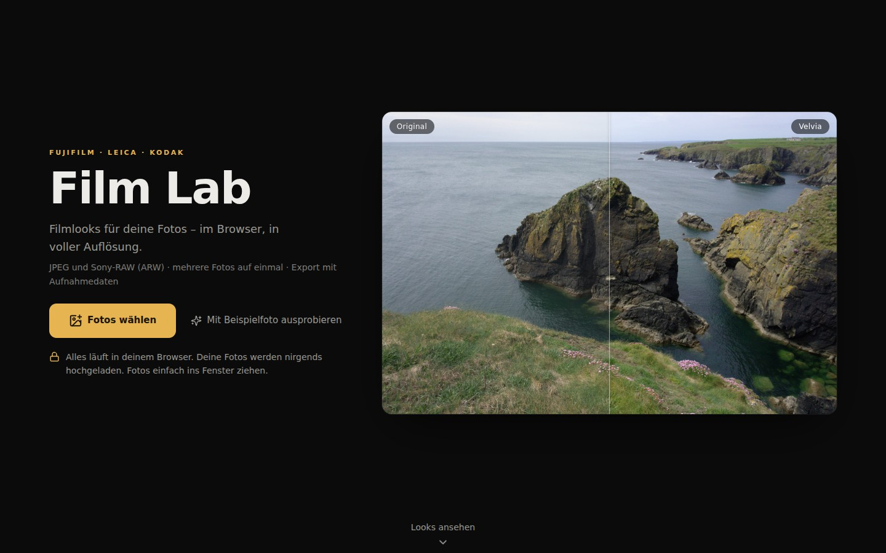
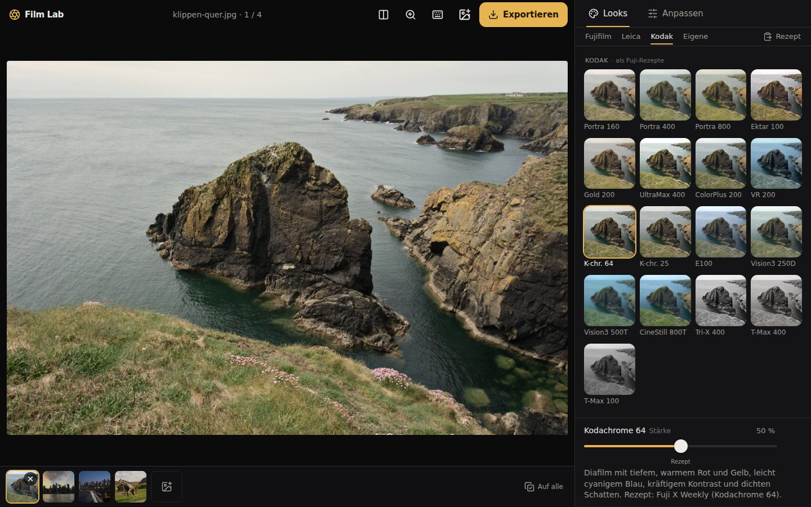
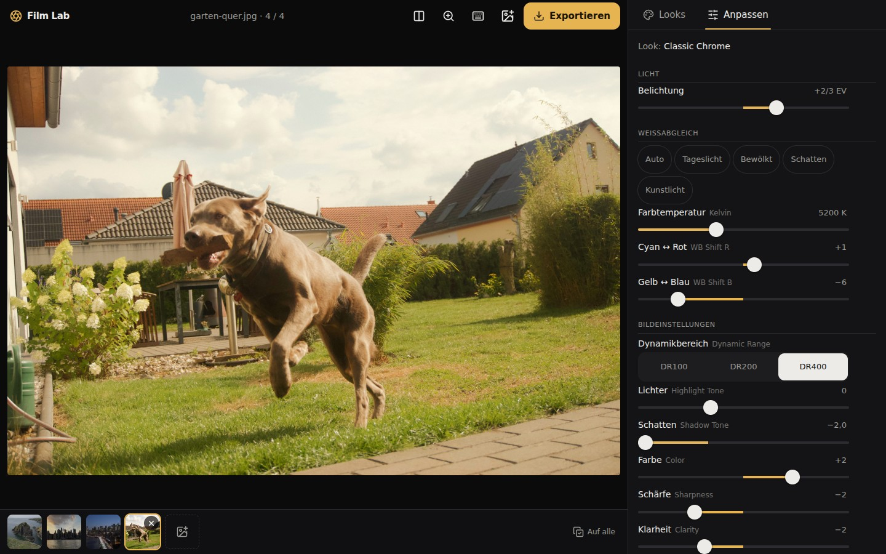
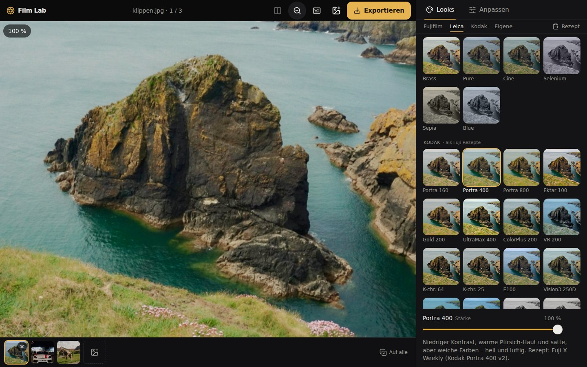
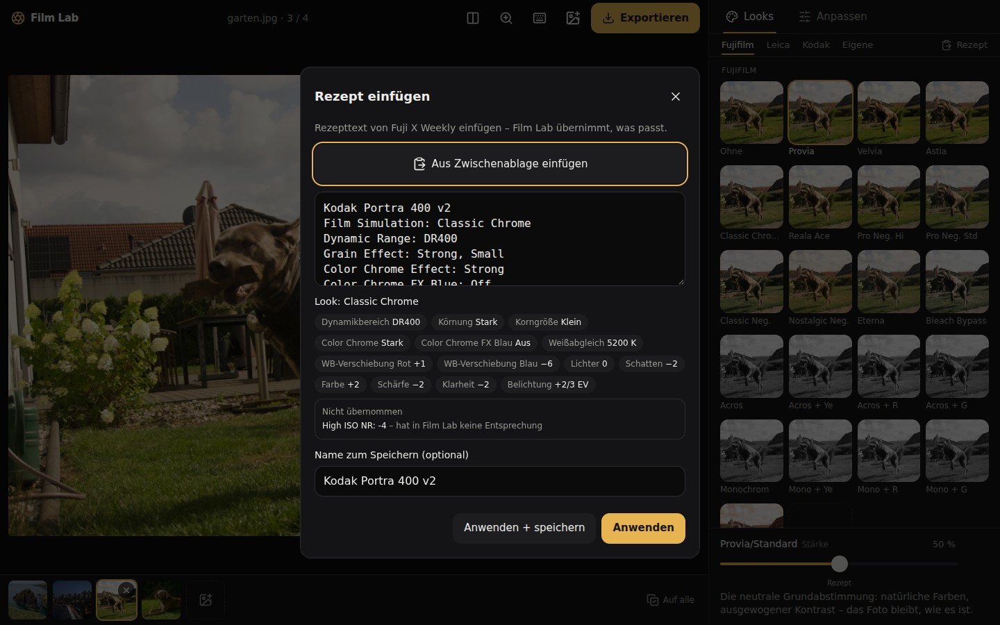
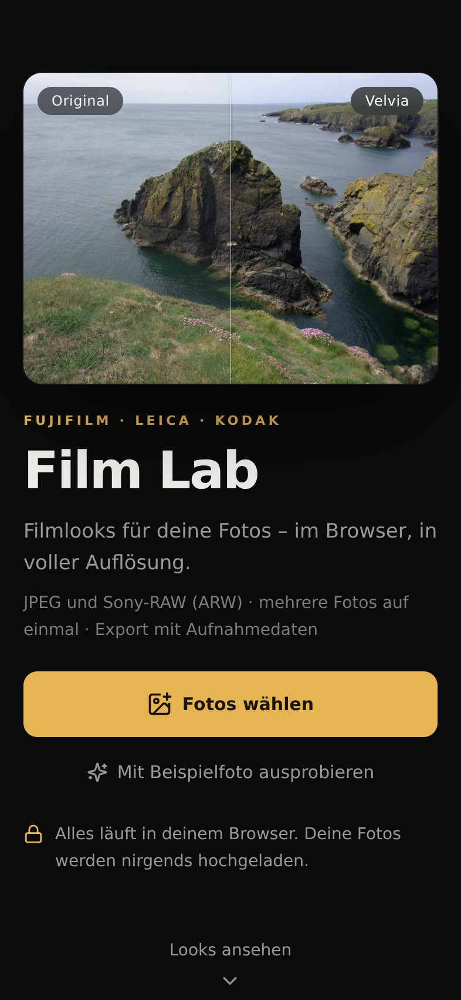
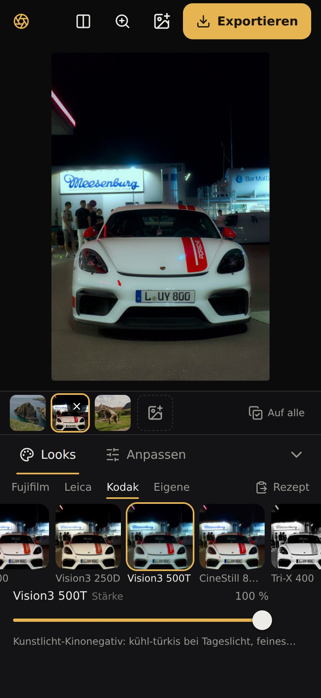
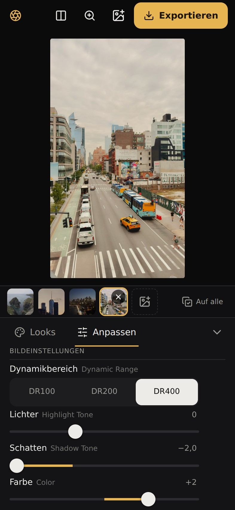
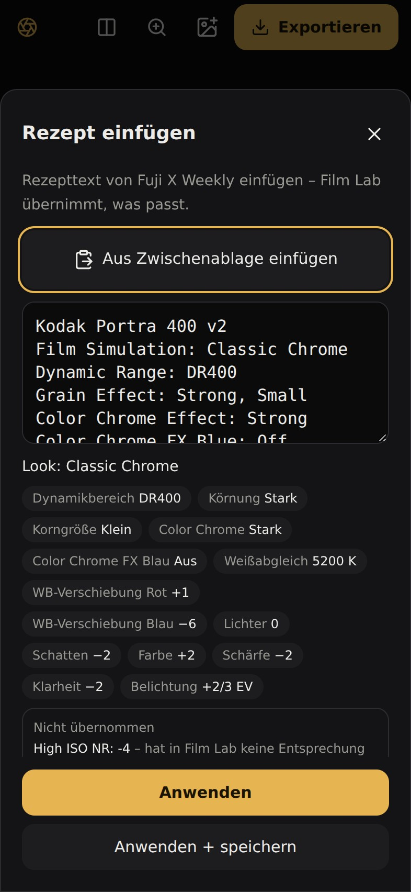

# Film Lab

**Kamera-Looks für deine Fotos – im Browser, in voller Auflösung.** Fujifilm-Filmsimulationen, Leica Looks und Kodak-Filme für Fotos der Sony a6000 und anderer Kameras, ohne Upload und ohne Konto.

**Live: [lab.hugobarthelmess.de](https://lab.hugobarthelmess.de)** · läuft auf iPhone und PC, installierbar als App

<p align="center">
  
</p>

## Funktionen

- **55 Looks.** 20 Fujifilm-Filmsimulationen (Provia, Velvia, Astia, Classic Chrome, Reala Ace, Pro Neg., Classic Neg., Nostalgic Neg., Eterna, Acros und Monochrom mit Filtern, Sepia u. a.), 18 Leica Looks (Standard, Vivid, Natural, Classic, Chrome, Teal, Cine, Selenium u. a.) und 17 Kodak-Filme als Fuji-Rezepte (Portra, Ektar, Gold, UltraMax, Kodachrome, Ektachrome, Vision3, CineStill 800T, Tri-X, T-Max u. a.). Alle sind nachempfunden, keine Originalprofile.
- **Einstellungen wie im Fuji-Menü.** Dynamikbereich (DR100/200/400), Lichter und Schatten, Farbe, Schärfe, Klarheit, Weißabgleich mit Feinabstimmung, Korn (Stärke und Größe), Color Chrome Effect und FX Blue, Monochrom-Tönung. Dazu Belichtung und als Extras Halation, Vignette und Lichtlecks. Der Stärke-Regler wirkt auf den ganzen Look samt Rezept-Einstellungen: 0 % ist das Original, 50 % der Look wie definiert, darüber wird er verstärkt; eigene Änderungen bleiben dabei voll erhalten.
- **Rezepte einfügen.** Den Text eines Rezepts von [Fuji X Weekly](https://fujixweekly.com) einfügen: Film Lab stellt Look und Einstellungen ein und zeigt, was es nicht übernehmen kann. Eigene Rezepte und `.cube`-LUTs bleiben im Browser gespeichert.
- **Offizielle Fujifilm-LUTs selbst laden (optional).** Für zehn Simulationen veröffentlicht Fujifilm eigene LUTs. Film Lab liefert sie nicht mit, weil sie Fujifilm gehören und laut Recherche nur für den persönlichen, nicht kommerziellen Gebrauch gedacht sind, ohne Abwandlung. Wer sie selbst bei Fujifilm lädt, bekommt die Looks noch näher am Original (siehe unten).
- **100-%-Lupe, Gesten, Tastenkürzel.** Die Lupe rechnet den Ausschnitt wie der Export, mit Korn und Schärfe. Bedienung am Handy per Wischen, Halten und Doppeltipp, am PC per Tastatur und Mausrad.
- **JPEG, PNG, HEIC und Sony-ARW.** RAW-Dateien entwickelt Film Lab im Browser (LibRaw als WebAssembly) und korrigiert auf Wunsch Verzeichnung und Farbsäume wie die Kamera (Korrekturdaten aus der ARW; Schalter unter „Anpassen“, ab Werk aus). Mehrere Fotos auf einmal, ein Look lässt sich auf alle übertragen.
- **Export in voller Auflösung** als JPEG (Qualität 92) mit den Aufnahmedaten (EXIF) der Quelle. Mehrere Fotos kommen am PC als ZIP, am iPhone über das Teilen-Menü.
- **Als App installieren, offline nutzen.** Film Lab ist eine PWA: Nach dem ersten Besuch läuft es auch ohne Netz.

### Bedienung

| Aktion | Handy | PC |
|---|---|---|
| Look wechseln | Auf dem Bild wischen | `↑` / `↓` oder Kachel anklicken |
| Original zeigen | Bild gedrückt halten | Bild gedrückt halten, `Leertaste` oder `\` halten |
| Vorher/Nachher-Teiler | Knopf in der Kopfleiste | `B` |
| 100-%-Lupe | Doppeltipp, dann Ziehen | Doppelklick oder `Z`, `Esc` verlässt sie |
| Foto wechseln | Filmstreifen am unteren Rand | `←` / `→` |
| Exportieren | Knopf „Exportieren“ | `Strg+E` (Mac `⌘E`) |
| Rückgängig, Foto entfernen | – | `Strg+Z`, `Entf` |
| Alle Kürzel | – | `?` |

## Bilder

<table>
  <tr>
    <td width="50%"><br><sub>Look-Auswahl: Kodachrome 64 auf dem Klippenfoto</sub></td>
    <td width="50%"><br><sub>Fuji-Bildeinstellungen, hier die eines eingefügten Rezepts</sub></td>
  </tr>
  <tr>
    <td width="50%"><br><sub>100-%-Lupe: Portra 400 mit Korn, Pixel für Pixel</sub></td>
    <td width="50%"><br><sub>Rezept einfügen: erkannte Werte und was nicht übernommen wird</sub></td>
  </tr>
</table>

Am Handy (393 × 852):

<table>
  <tr>
    <td width="25%"></td>
    <td width="25%"></td>
    <td width="25%"></td>
    <td width="25%"></td>
  </tr>
</table>

Die Bilder entstehen mit `node scripts/readme-screenshots.mjs` und zeigen nur die Beispielfotos aus `public/beispiele/`.

## Von der Sony a6000 aufs Handy

1. In **Imaging Edge Mobile** die Kamera verbinden und „An Smartphone senden“ wählen.
2. Die Bildgröße auf **„Original“** stellen, sonst überträgt die Kamera verkleinerte Fotos.
3. In Film Lab „Fotos wählen“ und die Bilder aus der Galerie nehmen.

RAW-Dateien (ARW) überträgt die Smartphone-Verbindung nicht. Sie kommen per Speicherkarte oder über den PC in Film Lab.

## Fujifilm-LUTs laden

1. In Film Lab bei den Fujifilm-Looks auf „Fuji-LUTs“ tippen. Der Dialog führt zur Download-Seite [fujifilm-x.com/support/download/lut](https://www.fujifilm-x.com/support/download/lut/).
2. Dort das Paket **„GFX ETERNA 55“** laden (ZIP).
3. Die ZIP-Datei im Dialog wählen oder ins Fenster ziehen. Film Lab rechnet daraus lokal neue Looks für Provia, Velvia, Astia, Classic Chrome, Reala Ace, Pro Neg. Std, Classic Neg., Eterna, Eterna Bleach Bypass und Acros. Pro Neg. Hi, Nostalgic Neg., die Acros-Filter, Monochrom und Sepia bleiben bei der eigenen Nachbildung.

Die Fujifilm-LUTs sind für Video (F-Log2) gedacht; Film Lab setzt sie für JPEG-Fotos um (Messungen in [docs/open-source-film-luts.md](docs/open-source-film-luts.md)). Die Dateien bleiben auf dem Gerät.

## Datenschutz

Alles läuft im Browser. Fotos werden nicht hochgeladen, die Seite setzt keine Cookies und hat kein Tracking. Die Content-Security-Policy erlaubt Verbindungen nur zur eigenen Seite ([`deploy/security-headers.conf`](deploy/security-headers.conf)), und der E2E-Test läuft unter genau dieser Policy. Rezepte, eigene LUTs und geladene Fujifilm-LUTs bleiben im Speicher dieses Browsers (localStorage und IndexedDB).

## Wie genau sind die Looks?

Die Looks sind **eigene parametrische Modelle** (Tonkurven, Farbmischung, Farbton-abhängige Korrekturen), keine kopierten Profile. Ihre Parameter sind gegen echte Kamerabilder abgestimmt: die Fuji-Looks gegen Kamera-JPEGs und gegen Fujifilms offizielle LUTs, die Leica Looks gegen die Beispielbilder von Leica, die Kodak-Filme als Rezepte der Fuji-Community, die selbst Annäherungen an die Filme sind.

Gemessen am mittleren Farbabstand ΔE2000 zu echten Kamerabildern (je Simulation 1 bis 6 Bildpaare, Stand 16.10.2026):

- Die Fuji-Looks kommen auf ΔE 0,2 bis 3,9. Ohne Look (das Original) wären es 1,2 bis 21.
- Fujifilms offizielle LUTs auf denselben Bildern: ΔE 0,6 bis 3,9. Der Nachbau liegt damit **meist 0 bis 0,3, höchstens 0,4 ΔE dahinter** (am größten bei Acros und Reala Ace).
- Das ist eine kleine Stichprobe. Die Referenzbilder und -LUTs gehören Dritten und liegen nicht im Repo.

Methode, Datenlage und Grenzen stehen in [docs/kamera-looks-referenz.md](docs/kamera-looks-referenz.md) (Fuji, Leica, Kodak) und [docs/open-source-film-luts.md](docs/open-source-film-luts.md) (vorhandene Nachbauten, Lizenzen, Messungen). Messskripte: `scripts/looks-fit.mjs`, `scripts/abgleich-pipeline.mjs`.

## Entwicklung

Voraussetzung: Node 22.

```bash
npm install
npm run dev            # Entwicklungsserver
npm test               # Typecheck, Lint, Unit-Tests (vitest)
npm run build          # Produktionsbuild nach dist/
```

Weitere Prüfungen, jeweils in headless Chrome mit WebGL2:

| Befehl | Prüft |
|---|---|
| `npm run test:browser` | Ende-zu-Ende unter der Produktions-CSP: Laden, Looks, Regler, Rezept, Export (PC und Handy) |
| `npm run test:pwa` | Precache, Offline-Start, Update, Installierbarkeit |
| `npm run test:engine` | WebGL-Pipeline: Nähte, Region, Export, Korn, Color Chrome |
| `npm run test:io`, `npm run test:raw` | JPEG-, EXIF- und ARW-Verarbeitung |
| `npm run ui:flow -- handy` oder `pc` | Bedienung der Oberfläche als Nutzer |
| `npm run ui:shots` | Bildschirmfotos aller Fenstergrößen nach `test-output/` |
| `npm run looks:sheet` | Kontaktbögen aller Looks |
| `npm run licenses` | `public/licenses.txt` neu erzeugen |

Der Browser kommt aus `CHROME_BIN` (Standard: `~/.local/bin/chrome-headless`, ein Wrapper für Chrome unter WSL). Auf anderen Rechnern `CHROME_BIN` auf ein Chrome oder Chromium setzen. Mit `TEST_PORT` lässt sich der Port wählen (Standard 5190), damit Läufe sich nicht stören. Ohne GPU rechnet Chrome per SwiftShader, das ist langsam.

Die Tests `test:browser`, `test:pwa`, `test:io`, `test:raw`, `ui:flow`, `ui:shots` und `looks:sheet` brauchen private Testfotos unter `testbilder/`. Der Ordner ist nicht im Repo (`.gitignore`). `test:engine` und `npm test` laufen ohne.

## Aufbau

Jedes Modul besitzt seinen Ordner. Der gemeinsame Vertrag (Typen und Einstiegspunkte) steht in [`src/types.ts`](src/types.ts).

| Ordner | Aufgabe | Einstieg |
|---|---|---|
| `src/looks/` | Looks als 3D-LUT, parametrisches Farbmodell, `.cube`-Parser, Umrechnung der offiziellen Fujifilm-LUTs (Worker). Reine Funktionen. | `LOOKS`, `parseCube`, `buildOfficialLuts` |
| `src/io/` | Dateien einlesen (JPEG, PNG, HEIC, ARW), Metadaten, JPEG kodieren, EXIF/ICC/XMP wieder einsetzen | `loadFile`, `encodeJpeg`, `withMetadata` |
| `src/engine/` | WebGL2-Pipeline für Vorschau, Lupe, Vorschaubilder und Export in voller Auflösung | `createEngine` |
| `src/ui/` | React-Oberfläche mit zustand: Startseite, Editor, Look-Auswahl, Einstellungen, Rezepte, Export | `App.tsx` |

Technik: Vite 6, React 19, TypeScript 5.9 (strict), Tailwind 4, zustand, lucide-react und vite-plugin-pwa.

## Deployment

Film Lab ist eine statische Seite in einem nginx-Container auf einem eigenen Server. Einrichtung, nginx, DNS und Zurücknehmen stehen in [docs/DEPLOY.md](docs/DEPLOY.md). Die CI ([`.github/workflows/ci.yml`](.github/workflows/ci.yml)) führt bei jedem Push Typecheck, Lint, Unit-Tests und Build aus. Ein grüner Push auf `main` wird per SSH deployt und geht live.

## Lizenzen und Marken

- **Drittanbieter:** Film Lab nutzt unter anderem LibRaw (LGPL-2.1 oder CDDL-1.0) für die RAW-Entwicklung, mozjpeg über `@jsquash/jpeg` (IJG, BSD-3-Clause, zlib; Wrapper Apache-2.0), `libraw-wasm` (ISC), fflate, React und zustand (MIT) sowie lucide-react (ISC). Hinweise und Quellen stehen in [THIRD_PARTY_NOTICES.md](THIRD_PARTY_NOTICES.md), die vollständigen Lizenztexte in [`public/licenses.txt`](public/licenses.txt) und unter [lab.hugobarthelmess.de/licenses.txt](https://lab.hugobarthelmess.de/licenses.txt).
- **Marken:** Fujifilm, Leica und Kodak sind Marken ihrer jeweiligen Inhaber. Film Lab steht in keiner Verbindung zu ihnen; die Looks sind Nachbildungen. Die offiziellen Fujifilm-LUTs gehören Fujifilm und sind nicht Teil dieses Repos.
- **Beispielfotos** in `public/beispiele/` und `docs/screenshots/`: © Hugo Barthelmess. Sie haben höchstens 4000 px an der langen Kante (Startseite 2048 px, Editor-Fassung in `public/beispiele/gross/`) und keine Aufnahmedaten (EXIF, GPS). Alle Rechte vorbehalten; für den eigenen Code liegt noch keine Lizenzdatei bei.
